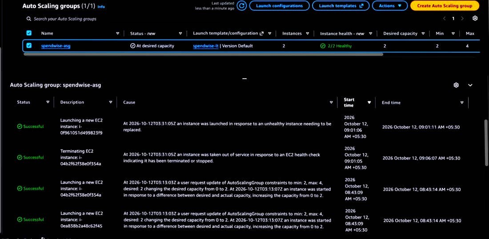
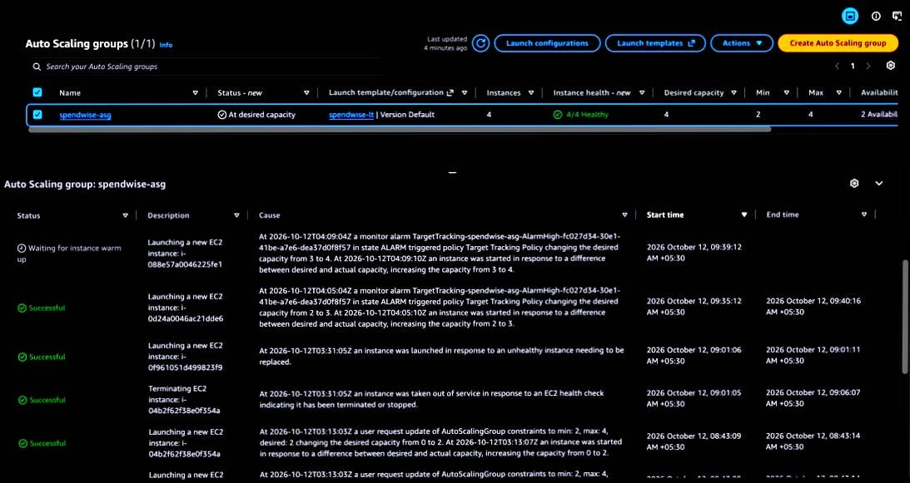
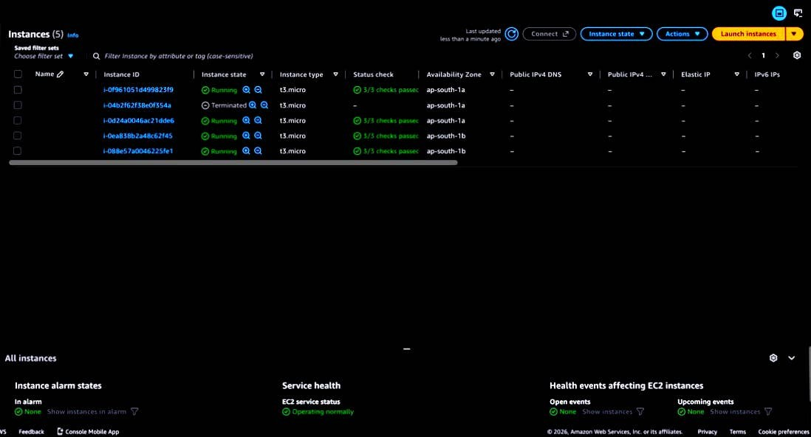
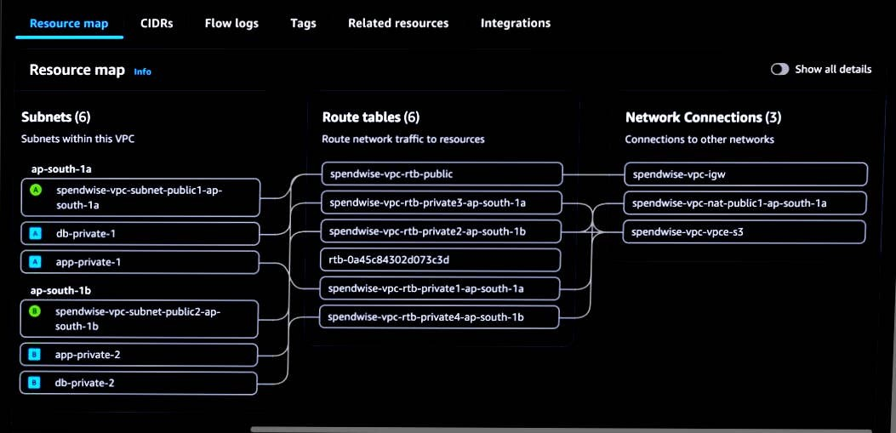
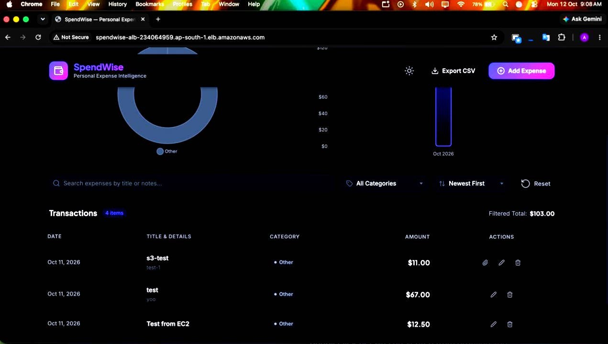
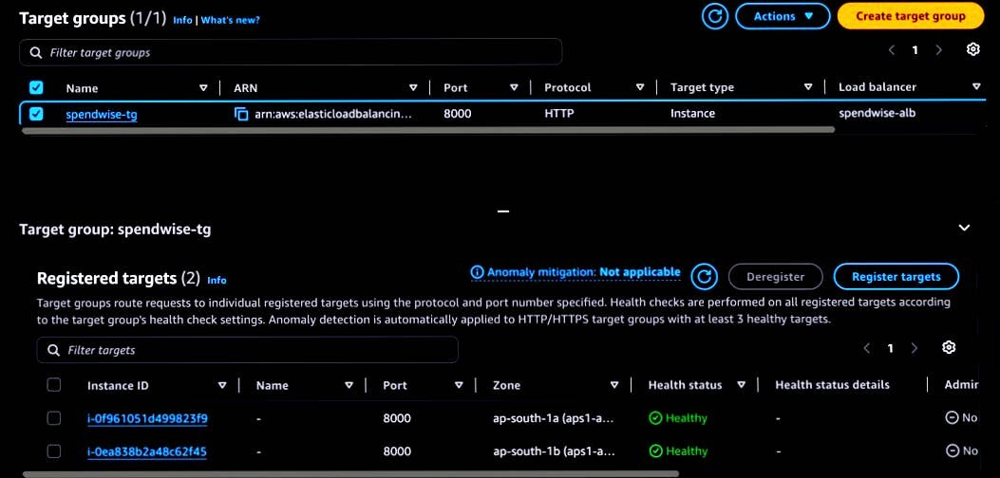
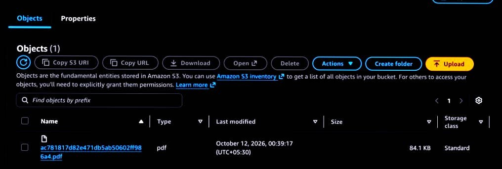

# SpendWise on AWS

A personal expense tracker (Flask + PostgreSQL) deployed on AWS as a highly available, auto-scaling, three-tier architecture. The application tracks expenses, shows spending charts, and lets you attach receipts that are stored privately in S3.

Region: `ap-south-1` (Mumbai)

## Architecture

```
                    USERS
                      |
                      v
              WEB BROWSER (HTTP)
                      |
                      v
        +-----------------------------+
        |  APPLICATION LOAD BALANCER  |
        |        (internet-facing)    |
        +-----------------------------+
              |                 |
              v                 v
     +---------------+  +---------------+
     | PUBLIC SUBNET |  | PUBLIC SUBNET |
     | AZ-a          |  | AZ-b          |
     | ALB node      |  | ALB node      |
     +---------------+  +---------------+
              |
              v   (port 8000, only from the ALB)
     +----------------------------------+
     |      PRIVATE APP SUBNETS         |
     |  +------------+  +------------+  |
     |  | EC2 (AZ-a) |  | EC2 (AZ-b) |  |
     |  | Ubuntu     |  | Ubuntu     |  |
     |  | Gunicorn + |  | Gunicorn + |  |
     |  | Flask      |  | Flask      |  |
     |  +------------+  +------------+  |
     |        Auto Scaling Group        |
     +----------------------------------+
              |
              v   (port 5432, only from the app servers)
     +----------------------------------+
     |      PRIVATE DB SUBNETS          |
     |   RDS PostgreSQL (no internet    |
     |   route, not publicly reachable) |
     +----------------------------------+

 SUPPORTING SERVICES
 -------------------
 EC2 --- IAM instance role --------> permissions, no stored keys
 EC2 --- Secrets Manager ----------> database password
 EC2 --- S3 (via gateway endpoint)-> private receipt storage
 ALB / ASG --- CloudWatch ---------> metrics and alarms
 CloudWatch alarm --- SNS ---------> email alerts
 You --- Systems Manager ----------> shell access, no SSH port open

 OUTBOUND INTERNET FOR PRIVATE SERVERS
 -------------------------------------
 Private app subnet -> NAT Gateway (public subnet) -> Internet Gateway
```

## What each component does

| Component | Configuration | Why it is there |
|---|---|---|
| **VPC** | `10.0.0.0/16`, 2 Availability Zones | An isolated network for everything |
| **Public subnets** (2) | `10.0.1.0/24`, `10.0.2.0/24` | Hold the load balancer and the NAT Gateway |
| **App subnets** (2, private) | `10.0.11.0/24`, `10.0.12.0/24` | Hold the web servers, which have no public IPs |
| **DB subnets** (2, private) | `10.0.21.0/24`, `10.0.22.0/24` | Hold the database. Their route tables have no route to the NAT or the internet |
| **Internet Gateway / NAT Gateway** | 1 NAT in one AZ | Gives the private servers outbound access (package installs, Secrets Manager, SSM) |
| **S3 gateway endpoint** | Free | Lets servers reach S3 without going through the NAT |
| **Application Load Balancer** | HTTP:80, internet-facing | Single public entry point, spreads traffic across servers |
| **Target group** | HTTP:8000, health check `/api/health` | Sends traffic only to healthy servers |
| **Launch template** | Ubuntu, `t3.micro`, user data script | The recipe for building a server with no manual steps |
| **Auto Scaling group** | min 2, desired 2, max 4 | Replaces failed servers and adds servers under load |
| **RDS PostgreSQL 16** | `db.t3.micro`, gp3, encrypted, single-AZ, private | The expense database |
| **Secrets Manager** | `spendwise/db-password` | Keeps the database password out of the code and the launch template |
| **S3 bucket** | Public access blocked | Stores receipts. Users get short-lived presigned links |
| **IAM role** | SSM, CloudWatch agent, S3 (this bucket only), read one secret | Servers get permissions with no stored credentials |
| **CloudWatch + SNS** | 3 alarms, email subscription | Health and scaling alarms, with an email alert on unhealthy servers |
| **Systems Manager** | Session Manager | Shell access with no SSH port and no key pairs |

### Security groups (a chain, not IP ranges)

| Group | Inbound |
|---|---|
| `spendwise-alb-sg` | 80 and 443 from the internet |
| `spendwise-app-sg` | 8000 from `spendwise-alb-sg` only |
| `spendwise-rds-sg` | 5432 from `spendwise-app-sg` only |

Rules reference other security groups, not IP addresses, so they keep working as Auto Scaling replaces servers and their IPs change.

## How the app is deployed

Each server builds itself from the launch template's user data script (`infra/user-data.sh`):

1. Installs git, Python and pip
2. Clones this repository to `/opt/spendwise`
3. Creates a virtual environment and installs `requirements.txt`
4. Creates a locked-down `spendwise` system user
5. Writes `start.sh`, which reads the database password from Secrets Manager and starts Gunicorn
6. Installs and starts a systemd service, so the app starts on boot and restarts if it crashes

The application reads its configuration from environment variables (`DB_HOST`, `DB_PASSWORD`, `DB_SSLMODE`, `S3_BUCKET`), so the same code runs locally and on AWS.

## Receipt uploads

- The browser sends the file to the Flask API, which stores it in a private S3 bucket under `receipts/<expense-id>/<random>.<ext>`
- Only JPG, PNG and PDF files up to 5 MB are accepted, checked in the browser and again on the server
- Viewing a receipt returns a presigned link that expires after 5 minutes
- Replacing or deleting an expense removes the old file from S3
- Servers reach S3 through the free gateway endpoint, not the NAT Gateway

## Auto Scaling demonstrations

**Self-healing.** One of the two instances was terminated by hand. Auto Scaling logged an EC2 health check failure at 09:01:05 and launched a replacement at 09:01:06 (IST, 12 Oct 2026). The load balancer kept serving traffic from the other instance, and the target group returned to two healthy targets once the replacement finished booting.



**Scale-out under load.** CPU was driven to about 99% on both instances. The target tracking alarm (average CPU above 60%) went into alarm, and the group grew from 2 to 3 instances (04:05:04 UTC) and then from 3 to 4 (04:09:04 UTC), which is the group maximum. The new instances registered with the target group and became healthy without any manual action.





## Screenshots

| | |
|---|---|
|  |  |
| VPC resource map: 6 subnets, IGW, NAT, S3 endpoint | The live app, with a receipt attached |
|  |  |
| Two healthy targets in two Availability Zones | A receipt stored in the private S3 bucket |

The full set (networking, security groups, database, load balancer, both demonstrations, IAM, alarms) is in [docs/screenshots.md](docs/screenshots.md). Account identifiers were redacted from the images.

## Security notes

- No SSH port is open and there are no key pairs. Shell access is through Session Manager.
- The database and the web servers have no public IP addresses.
- No secret is stored in the repository or the launch template.
- The S3 bucket blocks all public access.
- The IAM role is limited to one bucket and one secret.

## Known limitations

- The app has **no user accounts**. Everyone with the URL sees and edits the same data.
- The load balancer serves **HTTP only**.
- The application runs on a development-sized database (single-AZ `db.t3.micro`).
- CloudWatch collects metrics and drives alarms, but application logs are not shipped yet.

## Future improvements

- HTTPS: an ACM certificate and a custom domain, with HTTP redirected to HTTPS
- User accounts, with a `user_id` on each expense, so each person sees only their own data
- Multi-AZ RDS for database failover
- Install the CloudWatch agent through the launch template to ship application logs
- A WAF in front of the load balancer
- Infrastructure as code (Terraform), so the whole stack can be created and destroyed from one command
- A CI/CD pipeline with an Auto Scaling instance refresh on each release

## Repository layout

```
app.py                  Flask application and REST API
templates/index.html    Dashboard page
static/                 CSS and JavaScript
requirements.txt        Python dependencies
infra/
  user-data.sh          Launch template user data
  start.sh              App start script (fetches the DB password)
  spendwise.service     systemd unit
docs/
  screenshots/          Console and demo screenshots
  screenshots.md        Full screenshot gallery with captions
  troubleshooting.md    Problems hit while building, and the fixes
  teardown.md           How to delete everything and stop billing
```

## Cost note

The main hourly costs are the NAT Gateway, the Application Load Balancer, the RDS instance and the EC2 instances. This project was built to learn and demonstrate the architecture, and it was torn down afterward (`docs/teardown.md`).
