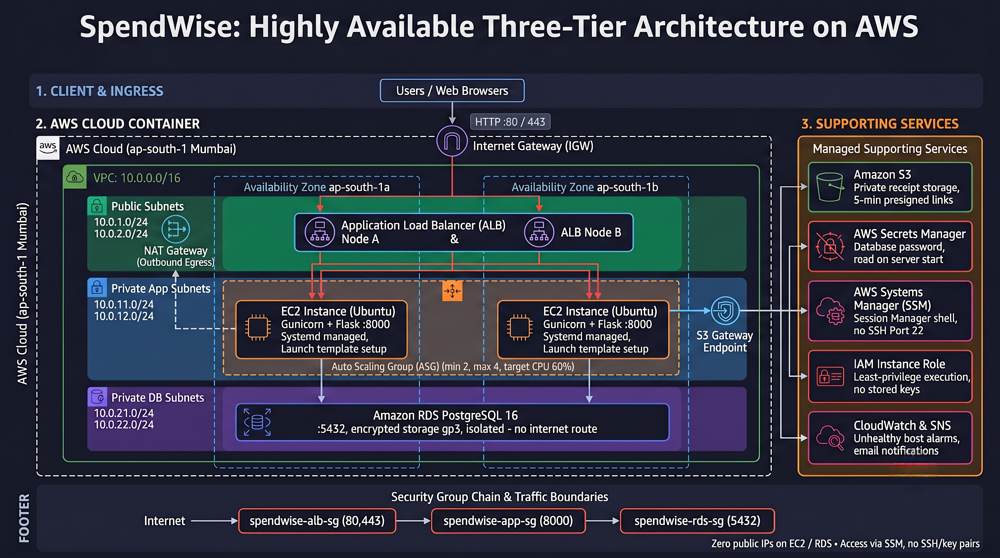
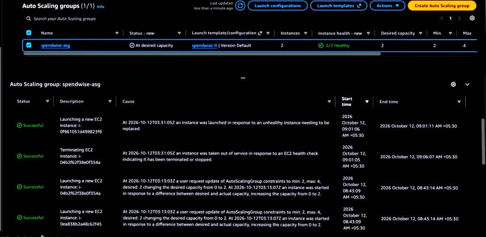
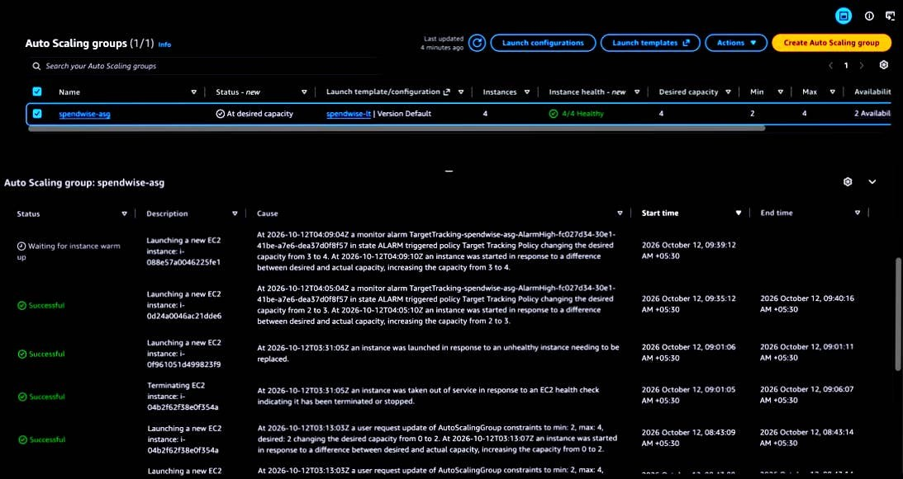
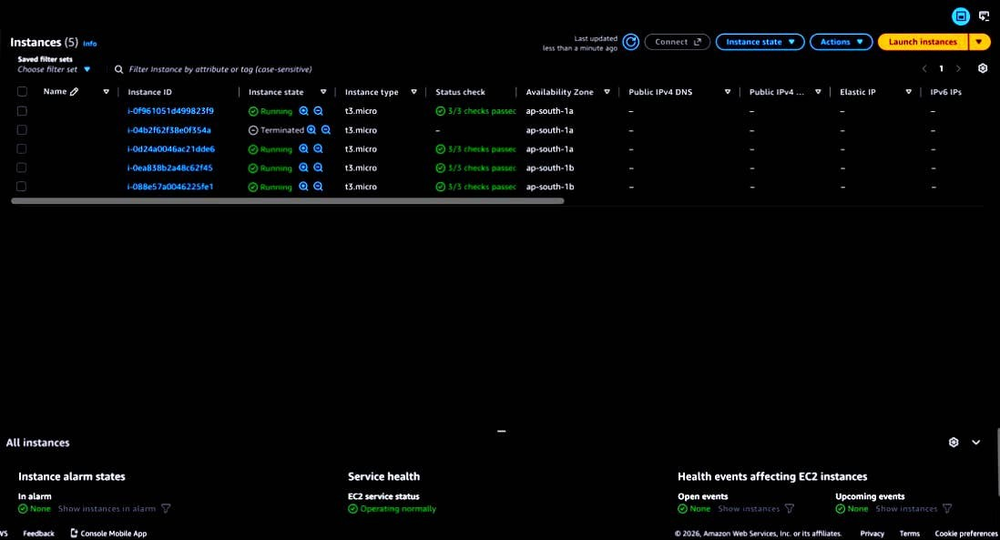
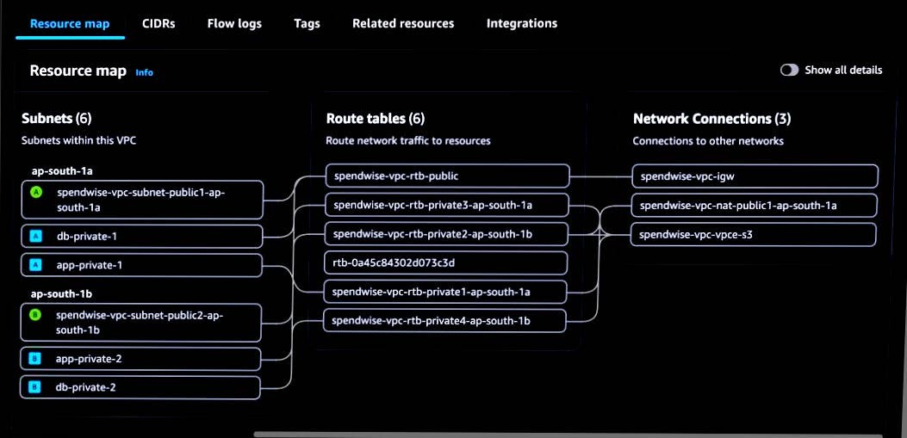
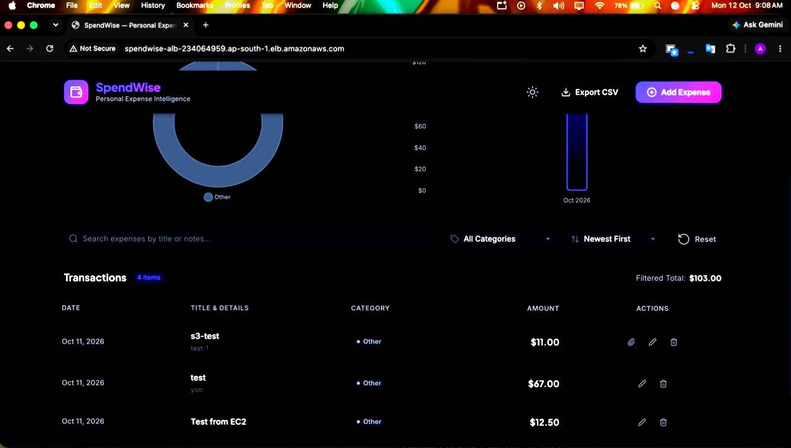
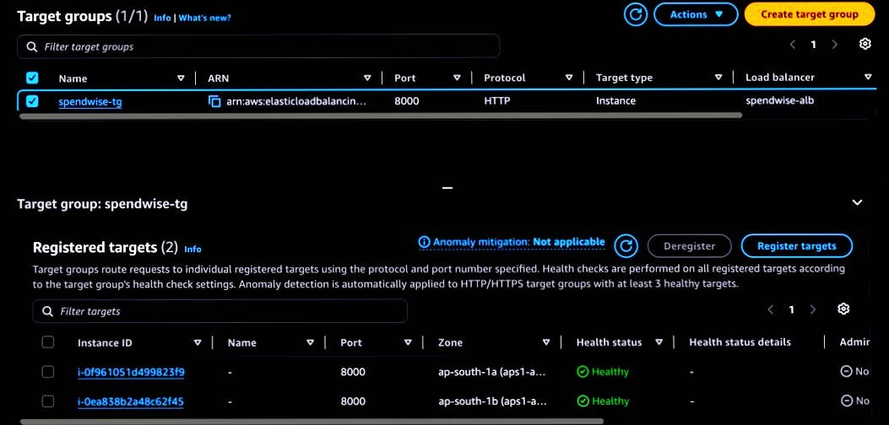
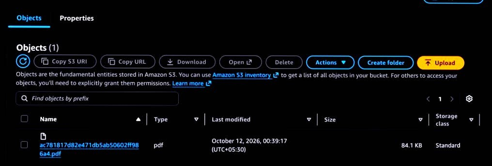

# SpendWise on AWS

A personal expense tracker (Flask + PostgreSQL) deployed on AWS as a highly available, auto-scaling, three-tier architecture. The application tracks expenses, shows spending charts, and lets you attach receipts that are stored privately in S3. It is also containerized with Docker and published to Docker Hub.

Region: `ap-south-1` (Mumbai)

## Features

- **Expense management:** create, view, edit and delete expenses
- **Spending analytics:** category breakdown, monthly trend and summary statistics
- **Search, filter and sort**, with dark and light themes
- **CSV export**
- **Receipt uploads:** attach a JPG, PNG or PDF to an expense, stored privately in S3
- **REST API** for expenses, categories, statistics and a health check
- **Docker support:** run the app and database with one command (`docker compose up`)

## Technology stack

| Layer | Technology |
|---|---|
| Frontend | HTML, CSS, JavaScript, Chart.js |
| Backend | Python, Flask, Gunicorn |
| Database | PostgreSQL 16 on Amazon RDS (psycopg2) |
| Compute | Amazon EC2 (Ubuntu) in an Auto Scaling group |
| Networking | VPC, public and private subnets, Internet Gateway, NAT Gateway, Application Load Balancer, security groups |
| Storage and secrets | Amazon S3, AWS Secrets Manager |
| Access and monitoring | IAM roles, Systems Manager Session Manager, CloudWatch, SNS |
| Containers | Docker, Docker Compose, Docker Hub (multi-platform image) |

## Architecture



<details>
<summary>Text version of the diagram</summary>

```
                    USERS
                      |
                      v
              WEB BROWSER (HTTP)
                      |
                      v
        +-----------------------------+
        |  APPLICATION LOAD BALANCER  |
        |        (internet-facing)    |
        +-----------------------------+
              |                 |
              v                 v
     +---------------+  +---------------+
     | PUBLIC SUBNET |  | PUBLIC SUBNET |
     | AZ-a          |  | AZ-b          |
     | ALB node      |  | ALB node      |
     +---------------+  +---------------+
              |
              v   (port 8000, only from the ALB)
     +----------------------------------+
     |      PRIVATE APP SUBNETS         |
     |  +------------+  +------------+  |
     |  | EC2 (AZ-a) |  | EC2 (AZ-b) |  |
     |  | Ubuntu     |  | Ubuntu     |  |
     |  | Gunicorn + |  | Gunicorn + |  |
     |  | Flask      |  | Flask      |  |
     |  +------------+  +------------+  |
     |        Auto Scaling Group        |
     +----------------------------------+
              |
              v   (port 5432, only from the app servers)
     +----------------------------------+
     |      PRIVATE DB SUBNETS          |
     |   RDS PostgreSQL (no internet    |
     |   route, not publicly reachable) |
     +----------------------------------+

 SUPPORTING SERVICES
 -------------------
 EC2 --- IAM instance role --------> permissions, no stored keys
 EC2 --- Secrets Manager ----------> database password
 EC2 --- S3 (via gateway endpoint)-> private receipt storage
 ALB / ASG --- CloudWatch ---------> metrics and alarms
 CloudWatch alarm --- SNS ---------> email alerts
 You --- Systems Manager ----------> shell access, no SSH port open

 OUTBOUND INTERNET FOR PRIVATE SERVERS
 -------------------------------------
 Private app subnet -> NAT Gateway (public subnet) -> Internet Gateway
```

</details>

## What each component does

| Component | Configuration | Why it is there |
|---|---|---|
| **VPC** | `10.0.0.0/16`, 2 Availability Zones | An isolated network for everything |
| **Public subnets** (2) | `10.0.1.0/24`, `10.0.2.0/24` | Hold the load balancer and the NAT Gateway |
| **App subnets** (2, private) | `10.0.11.0/24`, `10.0.12.0/24` | Hold the web servers, which have no public IPs |
| **DB subnets** (2, private) | `10.0.21.0/24`, `10.0.22.0/24` | Hold the database. Their route tables have no route to the NAT or the internet |
| **Internet Gateway / NAT Gateway** | 1 NAT in one AZ | Gives the private servers outbound access (package installs, Secrets Manager, SSM) |
| **S3 gateway endpoint** | Free | Lets servers reach S3 without going through the NAT |
| **Application Load Balancer** | HTTP:80, internet-facing | Single public entry point, spreads traffic across servers |
| **Target group** | HTTP:8000, health check `/api/health` | Sends traffic only to healthy servers |
| **Launch template** | Ubuntu, `t3.micro`, user data script | The recipe for building a server with no manual steps |
| **Auto Scaling group** | min 2, desired 2, max 4 | Replaces failed servers and adds servers under load |
| **RDS PostgreSQL 16** | `db.t3.micro`, gp3, encrypted, single-AZ, private | The expense database |
| **Secrets Manager** | `spendwise/db-password` | Keeps the database password out of the code and the launch template |
| **S3 bucket** | Public access blocked | Stores receipts. Users get short-lived presigned links |
| **IAM role** | SSM, CloudWatch agent, S3 (this bucket only), read one secret | Servers get permissions with no stored credentials |
| **CloudWatch + SNS** | 3 alarms, email subscription | Health and scaling alarms, with an email alert on unhealthy servers |
| **Systems Manager** | Session Manager | Shell access with no SSH port and no key pairs |

### Security groups (a chain, not IP ranges)

| Group | Inbound |
|---|---|
| `spendwise-alb-sg` | 80 and 443 from the internet |
| `spendwise-app-sg` | 8000 from `spendwise-alb-sg` only |
| `spendwise-rds-sg` | 5432 from `spendwise-app-sg` only |

Rules reference other security groups, not IP addresses, so they keep working as Auto Scaling replaces servers and their IPs change.

## How the app is deployed

Each server builds itself from the launch template's user data script (`infra/user-data.sh`):

1. Installs git, Python and pip
2. Clones this repository to `/opt/spendwise`
3. Creates a virtual environment and installs `requirements.txt`
4. Creates a locked-down `spendwise` system user
5. Writes `start.sh`, which reads the database password from Secrets Manager and starts Gunicorn
6. Installs and starts a systemd service, so the app starts on boot and restarts if it crashes

The application reads its configuration from environment variables (`DB_HOST`, `DB_PASSWORD`, `DB_SSLMODE`, `S3_BUCKET`), so the same code runs locally, in Docker and on AWS.

## Receipt uploads

- The browser sends the file to the Flask API, which stores it in a private S3 bucket under `receipts/<expense-id>/<random>.<ext>`
- Only JPG, PNG and PDF files up to 5 MB are accepted, checked in the browser and again on the server
- Viewing a receipt returns a presigned link that expires after 5 minutes
- Replacing or deleting an expense removes the old file from S3
- Servers reach S3 through the free gateway endpoint, not the NAT Gateway

## Auto Scaling demonstrations

**Self-healing.** One of the two instances was terminated by hand. Auto Scaling logged an EC2 health check failure at 09:01:05 and launched a replacement at 09:01:06 (IST, 12 Oct 2026). The load balancer kept serving traffic from the other instance, and the target group returned to two healthy targets once the replacement finished booting.



**Scale-out under load.** CPU was driven to about 99% on both instances. The target tracking alarm (average CPU above 60%) went into alarm, and the group grew from 2 to 3 instances (04:05:04 UTC) and then from 3 to 4 (04:09:04 UTC), which is the group maximum. The new instances registered with the target group and became healthy without any manual action.





## Screenshots

| | |
|---|---|
|  |  |
| VPC resource map: 6 subnets, IGW, NAT, S3 endpoint | The live app, with a receipt attached |
|  |  |
| Two healthy targets in two Availability Zones | A receipt stored in the private S3 bucket |

The full set (networking, security groups, database, load balancer, both demonstrations, IAM, alarms) is in [docs/screenshots.md](docs/screenshots.md). Account identifiers were redacted from the images.

## REST API

| Method | Endpoint | Purpose |
|---|---|---|
| GET | `/api/health` | Health check (used by the load balancer) |
| GET | `/api/categories` | List expense categories |
| GET | `/api/expenses` | List, search, filter and sort expenses |
| POST | `/api/expenses` | Create an expense |
| GET | `/api/expenses/<id>` | Retrieve one expense |
| PUT / PATCH | `/api/expenses/<id>` | Update an expense |
| DELETE | `/api/expenses/<id>` | Delete an expense (and its receipt) |
| GET | `/api/expenses/stats` | Spending statistics |
| POST | `/api/expenses/<id>/receipt` | Upload a receipt (JPG, PNG or PDF, max 5 MB) |
| GET | `/api/expenses/<id>/receipt` | Get a 5-minute link to view the receipt |

## Run locally

Requires Python 3, PostgreSQL 16 and Git. (Prefer not to install PostgreSQL? Use [Run with Docker](#run-with-docker) below instead.)

```bash
git clone https://github.com/Amrit-3/spendwise-aws-cloud-project.git
cd spendwise-aws-cloud-project
python3 -m venv venv
source venv/bin/activate
pip install -r requirements.txt
```

Create a local database named `expense_tracker` and a PostgreSQL user named `amrit`, then start the app:

```bash
python3 app.py
```

Open the URL it prints (usually `http://127.0.0.1:5000`; macOS may use 5001 because AirPlay holds 5000).

The app reads its settings from environment variables, and the defaults suit a local setup:

| Variable | Default | Purpose |
|---|---|---|
| `DB_HOST` | `localhost` | Database host (the RDS endpoint on AWS, `db` in Docker Compose) |
| `DB_NAME` | `expense_tracker` | Database name |
| `DB_USER` | `amrit` | Database user |
| `DB_PASSWORD` | none | Database password (from Secrets Manager on AWS) |
| `DB_SSLMODE` | `prefer` | Set to `require` for RDS, `disable` for the plain Postgres container |
| `S3_BUCKET` | none | Receipt bucket. When unset, uploads reply "not configured" and everything else still works |

Never commit passwords or AWS keys.

## Run with Docker

The Flask backend and PostgreSQL run as two containers managed by Docker Compose. The same `app.py` runs locally, in Docker and on AWS, because every setting is read from environment variables.

### Files

| File | Purpose |
|---|---|
| `Dockerfile` | Builds the Flask + Gunicorn image |
| `.dockerignore` | Keeps secrets and non-runtime files out of the image |
| `docker-compose.yml` | Runs the app and PostgreSQL together |
| `.env` (not committed) | Holds the database credentials for Compose |

### Quick start

1. Create a `.env` file next to `docker-compose.yml` (it is listed in `.gitignore`):

   ```
   DB_USER=amrit
   DB_PASSWORD=choose-a-password
   DB_NAME=expense_tracker
   ```

2. Start both containers:

   ```bash
   docker compose up -d
   ```

3. Open `http://localhost:8000`, or check the API:

   ```bash
   curl http://localhost:8000/api/health
   curl http://localhost:8000/api/expenses
   ```

4. Stop everything (the data is kept):

   ```bash
   docker compose down
   ```

The `web` service uses the published image `amritdsingh/spendwise:1.3`, so no local build is needed. Docker pulls the right architecture (amd64 or arm64) automatically.

### How it works

- **Dockerfile.** Based on `python:3.12-slim`. `requirements.txt` is installed before the rest of the code is copied, so Docker caches the pip layer and rebuilds stay fast. The app runs as a locked-down non-root user and starts with Gunicorn on `0.0.0.0:8000` (binding to `127.0.0.1` would make it unreachable from outside the container). `--no-control-socket` avoids a Gunicorn permission error for a user with no home directory.
- **Networking.** Compose creates a private network for the project. Flask reaches the database at `DB_HOST=db`, the service name, which Docker's built-in DNS resolves to the database container. The database publishes no port to the host, so only the app container can connect to it. This mirrors the AWS design, where `rds-sg` accepts traffic only from `app-sg`.
- **Startup order.** The database has a healthcheck (`pg_isready`), and the web service waits for it with `depends_on` and `condition: service_healthy`. The app creates its schema when it boots, so the database must be ready first.
- **Persistence.** Database files live in the named volume `pgdata`.

| Command | Containers | Data |
|---|---|---|
| `docker compose down` | removed | kept |
| `docker compose down -v` | removed | deleted |

- **SSL.** The plain Postgres image has no SSL, so Compose sets `DB_SSLMODE=disable`. On AWS the app uses `require` for RDS.

### Build and publish the image

The image is built for both amd64 (AWS EC2) and arm64 (Apple Silicon) and pushed in one step:

```bash
docker login
docker buildx build --platform linux/amd64,linux/arm64 \
  -t amritdsingh/spendwise:1.3 \
  -t amritdsingh/spendwise:latest \
  --push .
```

Pin a specific version tag (such as `1.3`) for anything you deploy. `latest` moves every time a new image is pushed.

To check what is inside a published image:

```bash
docker run --rm --entrypoint ls amritdsingh/spendwise:1.3 -la /app
```

A clean image contains only `app.py`, `requirements.txt`, `static/` and `templates/`.

### How Docker maps to the AWS build

| AWS | Docker |
|---|---|
| `start.sh` and systemd | Compose `environment` and `restart: unless-stopped` |
| RDS in a private subnet | `db` container with no published port |
| `rds-sg` allows only `app-sg` | Private Compose network |
| RDS storage | `pgdata` named volume |
| `git clone main` at boot | Versioned image on Docker Hub |
| Start RDS first, then the ASG | `depends_on` with a healthcheck |

### Lessons learned

- **A secrets leak, caught and fixed.** The first image I pushed (`1.0`) was built before `.dockerignore` existed, so `COPY . .` copied `.env` and `.git` into it. I found it by listing the image contents, added the ignore rules, rebuilt as a new tag, verified the result and deleted the old tags. Treat image tags as immutable: fix a problem by publishing a new version, not by overwriting.
- **Verify the file, not the intention.** An edit to `.dockerignore` that was never saved produced an identical image. A `CACHED` copy step in the build log and `nothing to commit` from git exposed it.
- **A `docker-compose.yml` is not a CloudFormation template.** Both are YAML, but only the first is read by Compose. A quick `head -5` shows which one you have.
- **Named volumes beat anonymous ones.** The first manual `docker run postgres:16` left behind an unnamed volume that was hard to attribute to a project.

## Testing

The application was tested manually: CRUD operations, validation, receipt upload and download, health checks behind the load balancer, self-healing and scale-out under load. The Docker setup was tested by starting the stack, adding data, running `docker compose down` and `up` again to confirm the volume kept the data, and pulling the published image on a clean state. The scripts `test_backend.py` and `verify_live_app.py` predate the PostgreSQL and S3 changes and have not been updated.

## Security notes

- No SSH port is open and there are no key pairs. Shell access is through Session Manager.
- The database and the web servers have no public IP addresses.
- No secret is stored in the repository, the launch template or the Docker image.
- The S3 bucket blocks all public access.
- The IAM role is limited to one bucket and one secret.
- The container runs as a non-root user, and the Compose database port is not published to the host.

## Known limitations

- The app has **no user accounts**. Everyone with the URL sees and edits the same data.
- The load balancer serves **HTTP only**.
- The application runs on a development-sized database (single-AZ `db.t3.micro`).
- CloudWatch collects metrics and drives alarms, but application logs are not shipped yet.
- The AWS deployment still builds each server from a `git clone` of `main` at boot. The Docker image is not yet used on AWS.

## Future improvements

- HTTPS: an ACM certificate and a custom domain, with HTTP redirected to HTTPS
- User accounts, with a `user_id` on each expense, so each person sees only their own data
- Multi-AZ RDS for database failover
- Run the Docker Hub image on AWS (ECS on Fargate or EC2) in place of the clone-at-boot method
- Install the CloudWatch agent through the launch template to ship application logs
- A WAF in front of the load balancer
- Infrastructure as code (Terraform), so the whole stack can be created and destroyed from one command
- A CI/CD pipeline that builds and pushes the image, then rolls it out with an Auto Scaling instance refresh

## Repository layout

```
app.py                  Flask application and REST API
templates/index.html    Dashboard page
static/                 CSS and JavaScript
requirements.txt        Python dependencies
Dockerfile              Container image for the Flask app
docker-compose.yml      App + PostgreSQL with a persistent volume
.dockerignore           Files excluded from the image
infra/
  user-data.sh          Launch template user data
  start.sh              App start script (fetches the DB password)
  spendwise.service     systemd unit
docs/
  screenshots/          Console and demo screenshots
  architecture.png      Architecture diagram
  screenshots.md        Full screenshot gallery with captions
  troubleshooting.md    Problems hit while building, and the fixes
  teardown.md           How to delete everything and stop billing
```

## Cost note

The main hourly costs are the NAT Gateway, the Application Load Balancer, the RDS instance and the EC2 instances. This project was built to learn and demonstrate the architecture, and it was torn down afterward (`docs/teardown.md`).

## License

MIT. See the `LICENSE` file.
